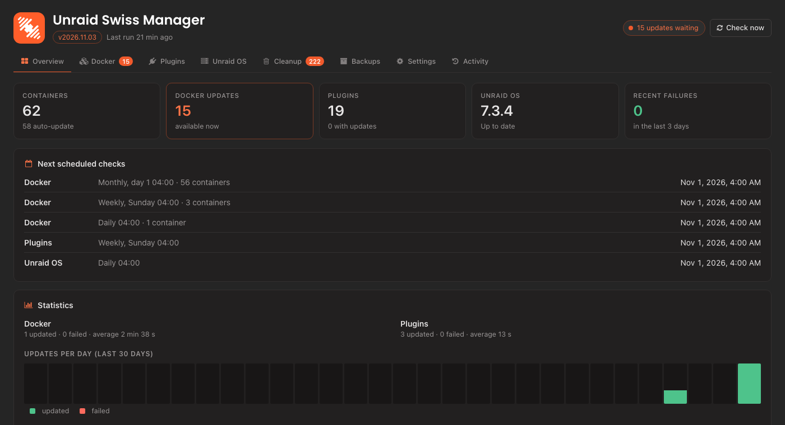

<p align="center"></p>

# Unraid Swiss Manager

<p align="center">


</p>

Keep your Unraid server up to date from one dashboard: Docker containers, plugins and Unraid OS, with schedules, safety checks, history and Discord notifications. It only uses Unraid's own update mechanisms and never bypasses its checks.

## Features

- **Docker containers** – global default plus a per-container policy (*Auto update*, *Notify only*, *Ignore*), schedule (every 6/12 hours, daily, weekly, bi-weekly, monthly), delay, maintenance window and optional safety backup. Updates are verified; the old image is only removed after success. Update order can follow dependencies, major-version jumps (databases) are held back for your approval, you can skip a version, and one click rolls a container back to its previous image.
- **Plugins** – update checks, notifications and optional automatic installation, per plugin, with safety validation and release notes.
- **Unraid OS** – checked and **notify only by default**. Automatic install and reboot are opt-in, with a maintenance window, a waiting period and a pre-update workflow (plugins first, health checks, optional confirmation).
- **Backups** – weekly or monthly backups of your **appdata folders** and of the **boot drive (USB flash)** to a folder you choose, optionally right before updates are installed. Keep 1, 2 or 3 copies: older ones are deleted only after a new backup succeeded, and the newest is never removed.
- **Cleanup** – guided Scan, Review, Clean for unused appdata folders (moved to a restorable quarantine first), Docker images, volumes, leftover containers and saved templates of removed containers. Every item says why it is listed, protected items cannot be selected, and there is a dry run and a confirmation that says what can be undone.
- **Discord and Unraid notifications** – optional webhook messages with action links, quiet hours, and notifications for failed backups.
- **Dashboard tile, history and statistics** – a compact status tile on the Unraid Dashboard, an activity log, readable colours in three themes, and a layout that works on a phone.
- **Settings you can keep** – save all settings to a named file and load them back, switch between the Stable and Beta plugin branch, or force-reinstall the current one.



## ⚠️ Disclaimer

This plugin was written by me with the help of AI assistants (Claude and ChatGPT). It has had only limited testing and is provided **"as is", without warranty of any kind**. It can update Docker containers and plugins and, if you enable it, install Unraid OS updates and reboot your server.

**Use it at your own risk.** I accept no responsibility or liability for data loss, downtime, or any other damage resulting from its use. Before installing, back up your flash drive and important data, and review the settings before turning on any automatic action.

## Install and update

In Unraid open **Plugins → Install Plugin**, paste the address of the branch you want, and click **Install**.

| Branch | For | Plugin address |
|---|---|---|
| **Stable** | Every server | `https://raw.githubusercontent.com/Stiphr/Unraid-Swiss-Manager/refs/heads/stable/unraid-swiss-manager.plg` |
| **Beta** | Test servers only: new features first, less tested | `https://raw.githubusercontent.com/Stiphr/Unraid-Swiss-Manager/refs/heads/beta/unraid-swiss-manager.plg` |

- Open it from **Swiss Manager** in the Unraid top menu, **Settings → User Utilities → Unraid Swiss Manager**, or its icon on the Plugins page.
- **Updates** appear on the Plugins page like for any other plugin, from the branch you installed.
- **Switch branch** at any time in the plugin under **Settings → Plugin branch**. Your settings, history and webhook are kept.

By default nothing is changed automatically: Docker auto-updates are off until a container is set to *Auto update*, and OS updates are notify-only.

### Coming from an older name?

The plugin used to be called *Unraid AutoUpdater* (`unraid-autoupdater.plg`) and, before that, *Docker Auto Update* (`docker.autoupdate.plg`). Just update the old entry from the Plugins page. It installs Unraid Swiss Manager, carries over your settings, history, webhook and backups, and the old entry disappears a few seconds later. The two old `.plg` files in this repository only exist for that move.

## More information

- [Detailed guide](docs/USAGE.md) – defaults, policies, Docker and OS update steps, backups, Discord, scheduling, data, limitations, troubleshooting, removal
- [Architecture](docs/ARCHITECTURE.md)
- [Changelog](CHANGES.txt)

## Development

```
python3 build.py 2026.10.28            # stable build: unraid-swiss-manager.plg + the redirect stubs
python3 build.py 2026.10.28b1 --beta   # beta build (commit it to the beta branch)
php tests/run.php                      # all tests, fully mocked (Linux; never on a real Unraid server)
```

Every push and pull request runs the same checks on GitHub Actions (`.github/workflows/tests.yml`): PHP syntax, the test suite on PHP 7.4, 8.3 and 8.4, and a plugin build.

Branches: `stable` is what the Stable address installs, `beta` what the Beta address installs. Versions are dates (`2026.10.28`, a letter for a second release that day, `b1`, `b2`… for betas). Unraid compares them as text, so each release must sort after the previous one on its branch.
